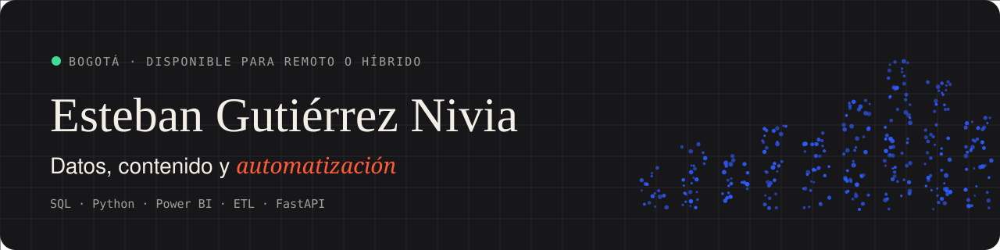

## Hola, soy Esteban

Analista de datos junior y creador de contenido en Bogotá, Colombia. Estudio séptimo semestre de Ingeniería de Sistemas en la UNAD y en 2024 hice el bootcamp de Data Science de Henry. Uso SQL, Python y Power BI para entender qué está pasando en los datos, y sé contarlo para que la gente lo entienda.

Estoy disponible para trabajar como **analista de datos, BI o marketing digital**, en remoto o híbrido.

**[Mira mi portafolio →](https://aestebangnivia23.github.io)**

## Proyectos destacados

| Proyecto | Qué hice | Herramientas |
| --- | --- | --- |
| [Recomendador de restaurantes en Tampa](https://github.com/nasae-nta/Google-Yelp) | Proyecto final de Henry en un equipo de 5: hice el dashboard completo en Power BI y apoyé los procesos ETL. | Power BI · Python · Google Cloud |
| [Siniestros viales en Buenos Aires](https://github.com/aestebangnivia23/SINIESTROS-VIALES-HENRY-) | ETL y análisis exploratorio de víctimas de 2016 a 2021, 3 KPI y un dashboard de 6 páginas. | Python · pandas · Power BI |
| [Recomendador de videojuegos de Steam](https://github.com/aestebangnivia23/Henry-Proyecto-1-steam) | Análisis de sentimiento de reseñas, modelo ítem a ítem con similitud de coseno y una API. | Python · NLTK · scikit-learn · FastAPI |
| Motor de edición automática de Reels | Pipeline que transcribe con Whisper, alinea cada palabra con el audio y genera subtítulos y gráficos. | Python · Whisper · Remotion |

## Herramientas

## Experiencia

- **Cofundador · Two Agency** (2026 – hoy): contenido para marcas personales, embudos en ManyChat y CRM en Notion.
- **Editor de video · Cortes Groove** (2025 – 2026): más de 100 piezas para clientes remotos.
- **Consultor de datos en formación · Rollup Consulting** (2025): consultas SQL y ETL en Oracle para un cliente del sector seguros.

## Contacto

[Portafolio](https://aestebangnivia23.github.io) · [LinkedIn](https://www.linkedin.com/in/estebanniv/) · [Instagram](https://www.instagram.com/estebanniv/) · aestebangnivia23@gmail.com
